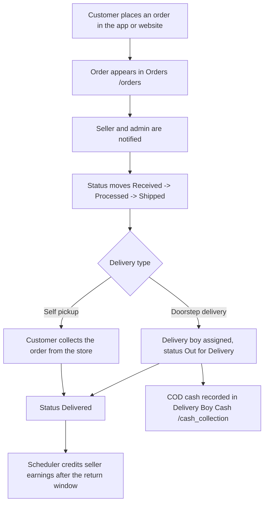

# eMarket Admin Panel — Detailed Documentation

This is the page-by-page guide to the **eMarket Admin Panel**. Each screen is described as it really is: the buttons, columns, form fields and rules you will find, step-by-step procedures, and short real-world examples.

:::tip Multi-Module Architecture
eMarket runs several business verticals (modules) in one installation — by default **Grocery**, **Pharmacy**, **Ecommerce** and **Food Delivery**. The **module selector** in the top header switches the panel's working module. Module-specific screens (orders, categories, products, Home Builder, delivery settings and so on) then show only that module's data, while the screens under **General** in the sidebar are shared by every module.
:::

---

## 1. Dashboard (`/dashboard`)

### Overview

The **Dashboard** is the first screen after login (the panel root `/` redirects here) and the first entry of the **MODULES** group in the sidebar. The **Dashboard** menu entry needs the `manage_dashboard` permission. Every figure on it belongs to the module selected in the header (for example **Grocery**), except the **Module comparison** card, which puts all active modules side by side. Nothing is changed from this page; it is a read-only summary of Orders, Products, Sellers and Customers, with links into those pages.

### 1.1 Header Controls

The top header is the same on every admin screen:

- **Sidebar toggle**: collapses or expands the left menu (on phones it opens the menu as a drawer).
- **Search** (also <kbd>Ctrl</kbd> + <kbd>K</kbd> / <kbd>⌘</kbd> + <kbd>K</kbd>): opens the quick search ("Search pages and settings…"). Type part of a menu entry or a setting name to jump straight to it. It only offers entries you are allowed to open — see the [tutorial below](#tutorial-jump-to-any-page-with-ctrl--k).
- **Demo mode badge**: appears only while demo mode is on (see [section 6](#6-demo-mode-read-only-panels)).
- **Setup progress pill** (e.g. "Setup 78%"): shown while the setup checklist is incomplete; opens the [Setup Checklist](#2-setup-checklist-setup_checklist). Hidden on the dashboard itself, on the checklist page and once setup is complete.
- **System Status button**: shown only while a [System Status](./system-maintenance.mdx) check has a warning or error; it opens `/system_status`.
- **Module selector**: the active module's icon and name. Pick another module from the dropdown to switch the whole panel to it (see [Switching modules](#tutorial-switch-to-another-module)).
- **Theme toggle** (moon / sun icon): switches between the light and dark theme (see [section 5](#5-light-and-dark-theme)).
- **Website link** (globe icon): opens the customer website in a new tab.
- **Notifications bell**: unread-count badge and a dropdown with the latest panel notifications, **Read all notifications**, and **See all notifications** (opens the notification panel).
- **Language selector**: switches the panel language among the languages added under **Languages**.
- **Profile menu**: shows "Hello, *username*!", **Settings** (the Super Admin's account settings at `/settings` — not the Settings hub; see the [Settings Guide](./settings.mdx)) and **Logout**. On phones the website link and language selector move into this menu.

:::note
There is no "Clear Cache" button in the header. The cache is cleared from **Settings → System → Clear System Cache** (Super Admin only) — see [System Status, Logs & Updates](./system-maintenance.mdx#4-clearing-the-system-cache).
:::

### Tutorial: Jump to any page with Ctrl + K

*Scenario:* you want to change the minimum order amount but do not remember which Settings card holds it.

1. On any admin screen press <kbd>Ctrl</kbd> + <kbd>K</kbd> (<kbd>⌘</kbd> + <kbd>K</kbd> on a Mac), or click **Search** in the header.
2. Type a few words, e.g. `minimum order`. Every word must appear in the entry's title or description, so `cart minimum` works too.
3. Results are grouped under **Menu** (sidebar entries) and **Settings** (Settings hub cards and Store Settings sections). Use <kbd>↑</kbd> / <kbd>↓</kbd> to move and <kbd>Enter</kbd> to open, or click the entry.
4. Press <kbd>Esc</kbd> (or the shortcut again) to close the box without opening anything.

**Result:** the matching page (here **Cart Setting**) opens directly. Entries your role cannot open are never listed, so two staff members may see different results for the same words.

### 1.2 Welcome Bar and Quick Actions

The top of the page greets the logged-in user (**Welcome, *name***) and offers two quick buttons, each shown only with the matching permission:

- **View Orders** → `/orders` (needs `order_list`).
- **Add Product** → `/manage_products/create` (needs `product_create`).

### 1.3 Today's Cards

Four cards with today's figures for the current module:

| Card | What it shows | Example (demo data) |
| :--- | :--- | :--- |
| **Today Order** | Orders placed today. | 10 |
| **Today Revenue** | Order value received today, with the store currency symbol. | ₹4,844 |
| **Today Returns** | Return requests raised today. | 0 |
| **Today Cancelled** | Orders cancelled today. | 0 |

### 1.4 Setup Progress Card

While setup is incomplete, a **Setup progress** card appears under the welcome bar: a progress bar ("*N*% complete", "*N* steps remaining"), a numbered stepper of every step (general steps plus the current module's steps), and a **Next step** box naming what is missing with a **Set up now** button. **View checklist** opens `/setup_checklist`; the chevron collapses the card. The card disappears once every step is done.

### 1.5 Charts and Panels

| Panel | Contents | Period filter |
| :--- | :--- | :--- |
| **Sales Overview** | Bar chart of **Orders** and **Revenue**. | Yearly / Daily / Weekly |
| **Order Status** | Count per status with a coloured icon and bar — e.g. Payment Pending 4, Received 6, Processed 4, Shipped 4, Out for Delivery 7, Delivered 60. | Yearly / Monthly |
| **Business Performance** | Six tiles: **Total Orders**, **Revenue**, **Average Order Value**, **Active Customers**, **Pending Orders**, **Delivered Orders** (e.g. 116 orders, ₹61,287 revenue, ₹528.34 average). Some tiles show a trend pill (e.g. ↗ 65.7%) when the server sends one. | — |
| **Module comparison** | Every active module side by side: Orders, Revenue, Share of revenue, Avg. order, Cancelled, Products, Sellers, plus a total row. The current module is tagged **Current**. | Date range picker (presets such as last 7 / 30 days, this / last month, this year, or a custom range) |
| **Top Sales by Category** | Ranked categories with their sales and the **Total Sales** figure. | Yearly / Monthly |
| **Catalog & Inventory** | Tiles for **Products**, **Sellers**, **Categories**, **Brands**, **Sold Out** and **Low Stock**. Tiles link to their list when you have the permission; Sold Out and Low Stock have a **View** link to Stock Management. | — |
| **Customers by Platform** | **Total Users** split into **Web**, **Android (App)** and **iOS (App)** with percentages. | Yearly / Monthly |
| **Top Selling Products** | Product image, name, units sold and revenue; paged with a **Per page** selector. | Yearly / Monthly |
| **Top Rated Products** | Product image, name, number of reviews and average rating; paged. | Yearly / Monthly |
| **Highest Revenue Sellers** | Store logo, store name, order count and revenue; paged. | Yearly / Monthly |
| **Recent Orders** | Table: Order ID, Customer, Seller, Total Items, Payment, Order Date & Time, Status, Action (view). A **View Orders** button opens the full list. | Paged list |

:::info
Seller earnings are credited by the scheduler (`sellers:credit-earnings`, every 15 minutes), not by opening the dashboard. If the scheduler is not running, sellers are not credited — see [System Status, Logs & Updates](./system-maintenance.mdx#5-the-scheduler-requirement).
:::

### 1.6 Tutorial: Read the Dashboard Each Morning

*Scenario:* the store manager of a grocery store opens the panel at 9 AM before the packing team starts.

1. Open `/dashboard` and check that the **module selector** shows **Grocery**. If not, switch it (the figures are per module).
2. Look at the header first. If a **System Status** button is visible, open it and fix the flagged check before anything else — a stopped scheduler, for example, means sellers are not credited.
3. Read the four **Today** cards. A spike in **Today Cancelled** or **Today Returns** compared with a normal day is worth a look in [Orders](./orders.mdx) or Return Requests.
4. In **Order Status**, note how many orders sit in **Received** and **Processed** — those still need packing or a delivery boy. Click **View Orders** (top right) to work through them.
5. Scroll to **Catalog & Inventory**. If **Sold Out** or **Low Stock** is above 0, click **View** to open Stock Management and restock.
6. Glance at **Recent Orders** for anything unusual (a very large order, a failed payment) and open it with the view action.
7. Once a week, set **Module comparison** to **Last 1 month** and compare revenue and cancellations across modules.

**Result:** in a few minutes you know today's workload, any system problem and the stock gaps, without opening each list.

:::tip Tips & common mistakes
- All cards except **Module comparison** follow the header's module. "Today Order 0" usually means the wrong module is selected, not a quiet day.
- The period filters (Yearly / Monthly / Daily / Weekly) apply only to their own panel.
- Seller earnings and expired subscriptions are processed by the scheduler, not by the dashboard; if numbers look stale, check **System Status → Scheduler**.
- Buttons such as **Add Product** and **View Orders** are hidden when your role lacks `product_create` or `order_list`.
:::

### 1.7 Real-World Use Cases

- **Morning stand-up**: the operations lead reviews today's cards and Recent Orders before the dispatch team starts.
- **Comparing verticals**: the owner sets **Module comparison** to the last 30 days to see which module brings the most revenue and the most cancellations.
- **Stock alerts**: a non-zero **Sold Out** tile leads the catalog team straight to Stock Management.

---

## 2. Setup Checklist (`/setup_checklist`)

### Overview

The **Setup Checklist** lists the minimum settings and data the system needs before seller registration, delivery boy registration and customer ordering work properly. It is open to every admin role (it is not in the sidebar): reach it from the dashboard's **View checklist**, the header's setup pill, or **Settings → System → Setup Checklist**. It only reads your data; each step links to the page where you fix it.

### Key Components

- **Overview card**: a progress ring (e.g. **100%**), "Minimum setup to start the system" (or "Everything is set up" when complete), the done count for General plus the current module (e.g. "14 / 14 done (General + Grocery)"), one chip per module (e.g. **Grocery 3/3**, **Pharmacy 0/3**) and a **Refresh** button.
- **Expand All / Collapse All** links above the sections.
- **General (all modules)** section — set once for the whole system:
  - Modules, Store details, Store address & map, Currency, Date & time zone, Cities, Seller settings, Login settings, Firebase, Payment methods (at least one).
  - Theme is **Optional** (counts as done); Mail (SMTP) is **Recommended** and does not count towards the percentage.
- **One section per module** (Grocery, Pharmacy, …) — data kept separately for each module: Categories, Attributes and Delivery time slots. The current module is tagged **Current module**.
- Each section header shows its own percentage, done/total and a progress bar, even when collapsed. Completed sections start collapsed; your open/closed choice is remembered in the browser.
- Each step lists what is missing as small tags (e.g. "No main category", "No attribute", "Delivery settings not saved") and has a **Set up now** button (or **Review** when done). Opening another module's step **switches the panel to that module** first.

### What Each Step Checks

| Step | Done when |
| :--- | :--- |
| Modules | At least one module is active. |
| Store details | App name, support email, support number and logo are filled. |
| Store address & map | Store address, latitude and longitude are set (plus the Google Places key when the map provider is Google). |
| Currency | Currency symbol, currency code and decimal places are set. |
| Date & time zone | Time zone, date format and time format are set. |
| Cities | At least one city exists. |
| Seller settings | A seller commission is set. |
| Login settings | At least one customer login method is on; with phone login, an OTP method (Firebase or custom SMS gateway) is on too. |
| Firebase | The Firebase keys are filled and the service-account file is uploaded. |
| Payment methods | At least one payment method is on. |
| Theme | Always done (optional — the default theme works). |
| Mail (SMTP) | SMTP host, port, from address and password are set. Recommended only; not counted. |
| Categories *(per module)* | At least one active main category in that module. |
| Attributes *(per module)* | At least one active attribute in that module. |
| Delivery time slots *(per module)* | The module's delivery settings are saved, and a time slot exists when fixed time slots are on. |

### Tutorial: Complete the Checklist for a New Module

*Scenario:* the store already sells groceries and now wants to open the **Pharmacy** module. The checklist shows **Pharmacy 0/3**.

1. Open `/setup_checklist` and click the **Pharmacy** section to expand it. It shows **Categories** ("No main category"), **Attributes** ("No attribute") and **Delivery time slots** ("Delivery settings not saved").
2. Click **Set up now** on **Categories**. The panel switches the header to **Pharmacy** and opens the category page. Add an active main category (e.g. "Medicines") and save.
3. Go back to the checklist and click **Set up now** on **Attributes**. Add an active attribute (e.g. "Pack size") and save.
4. Back on the checklist, click **Set up now** on **Delivery time slots**. Save the Pharmacy delivery settings; if you turn on fixed time slots, add at least one time slot.
5. Return to the checklist and click **Refresh**.

**Result:** the Pharmacy section shows **100%** and **3 / 3**, its chip turns green, and the module is ready for sellers and customers. The header stays on **Pharmacy** until you switch back.

:::tip Tips & common mistakes
- Module steps are checked separately for each active module — adding a category in Grocery does not complete Pharmacy.
- Inactive modules are not listed. Activate the module on [Modules](#3-modules-modules) first.
- The page does not refresh by itself after you save elsewhere; click **Refresh**.
- Mail (SMTP) can stay unset without lowering the percentage, but password-reset and order emails will not be sent until it is set.
:::

### Real-World Use Cases

- **New installation**: a fresh install uses the checklist as its go-live list, so no required setting is forgotten.
- **Adding a vertical**: after activating the Pharmacy module, the admin sees exactly which categories, attributes and time slots that module still needs.

---

## 3. Modules (`/modules`)

### Overview

The **Modules** page (sidebar **GENERAL → Modules**) manages the business verticals of the installation. Modules are shown as cards; there is no "add module" button — the installation ships with **Grocery** (#1, default), **Pharmacy** (#2), **Ecommerce** (#3) and **Food Delivery** (#4). Needs the `module_list` permission. The active modules, their names, icons and order are what customers see as module choices in the apps and on the website, and what you can pick in the header's module selector.

### Key Components

- **Search** box and **Refresh** button.
- **Module card**: icon, name, `#ID`, a **Default** badge on the default module, the description, an **Active / Inactive** switch, and the **Edit** action.
- **Drag to reorder**: when no search is active, drag a non-default module by its handle to change the order of the modules.
- **Edit Module** modal, one tab per language (with **Translate Empty Fields** / **Translate & Overwrite** on the default-language tab when more than one language exists).

### Field Reference: Edit Module

| Field | Required | What it does | Example |
| :--- | :--- | :--- | :--- |
| **Name** | Yes (default language) | Module name in the panel, apps and website. | Pharmacy |
| **Slug** | Yes | URL-friendly name; must be unique among modules. | pharmacy |
| **Description** | No | Short text shown on the card ("No Description" when empty). | Medicines and wellness |
| **Image** | No | Module icon. SVG only, max 2 MB, single colour on a transparent background; the apps and website colour it with the module colour. | pharmacy.svg |
| **Status** | Yes | Activate / Deactivate the module. | Activate |
| **Set as a default module** | No | The module the panel and apps open on. Only one module can be default. | Off |

### Tutorial: Switch to Another Module

*Scenario:* you manage Grocery orders all morning and now need to add a product to **Pharmacy**.

1. Click the **module selector** in the header (it shows **Grocery** and its icon).
2. Pick **Pharmacy** from the dropdown. The panel reloads.
3. The sidebar **MODULES** group now works on Pharmacy data: Orders, Categories, Products, Sellers, Home Builder, Page Builder, Promo Code, Delivery Settings, Blogs and the Dashboard figures all show Pharmacy only.
4. The **GENERAL** group (Delivery Boys, Settings, Customers, Languages, System Users, FAQs…) stays the same — it is shared by every module.

**Result:** new categories, products and promo codes you create now belong to Pharmacy. The choice is remembered in this browser, so the panel opens on Pharmacy next time until you switch back.

### Tutorial: Turn Off a Module You Do Not Use Yet

1. Open `/modules`.
2. On the **Food Delivery** card, switch the toggle to **Inactive**.
3. To rename it or change its icon instead, click the **Edit** (pencil) button, update the fields and click **Save**.

**Result:** Food Delivery disappears from the module choices in the apps and website, from the header selector and from the Setup Checklist. Its data is kept and comes back when you activate it again.

:::caution Common mistakes
- At least one module must stay active, and the **default** module cannot be deactivated — make another module the default first.
- You cannot remove the default flag without giving it to another module ("at least one module must be default").
- Drag-to-reorder is disabled while a search term is typed, and the default module cannot be dragged.
- Switching modules in the header affects only your own browser; other staff keep their own selection.
:::

### Real-World Use Cases

- **Grocery-only launch**: a store that starts with groceries switches Pharmacy, Ecommerce and Food Delivery to **Inactive** until it is ready.
- **Local naming**: the admin renames "Ecommerce" to "Electronics" and adds translations for each language.

---

## 4. Sidebar Menu Structure

The admin sidebar has two groups. An entry appears only when your role has its permission; **System Users** and **Role** appear for the Super Admin only. A dot next to an entry marks pending items (for example new seller requests).

**MODULES** (data of the module selected in the header)

| Menu | Sub-entries |
| :--- | :--- |
| Dashboard | — |
| Orders | — |
| Self Pickup Orders | — |
| Abandoned Carts | — |
| Categories | Add Category, Manage Categories |
| Products | Add Product, Manage Products, Approve Requests, Product Ratings, Media, Bulk Upload, Bulk Update, Taxes, Brands, Addons (Food Delivery only), Attributes, Product Order |
| Stock Management | — |
| Sellers | Add Seller, Seller Requests, Manage Sellers, Seller Wallet Transactions, Seller Policies |
| Home Builder | Home Builder, Page Builder, Manage Popup Offer |
| Promo Code | Add Promo Code, Manage Promo Code |
| Return Requests | — |
| Custom Fields | — |
| Withdrawal Requests | — |
| Theme Settings | — |
| Delivery Settings | Delivery Settings, Delivery Boy Assignment |
| Blogs | Blog Categories, Blogs |

**GENERAL** (shared by every module)

| Menu | Sub-entries |
| :--- | :--- |
| Modules | — |
| Delivery Boys | Add Delivery Boy, Delivery Boy Requests, Manage Delivery Boys, Fund Transfers, Delivery Boy Cash, Delivery Boy Policies, Salary |
| Notifications | Send Notifications, Manage Notifications |
| Email | Email Templates, Manage Emails |
| Settings | Opens the Settings hub (`/system_settings`) with a card for every setting page |
| Subscriptions | Subscription Plans, Subscriptions FAQs |
| Languages | Add Language, Manage Languages |
| Countries | Add Country, Manage Countries |
| Location | Add City, Manage Cities |
| Customers | Customers, Wishlists, Product Requests, Wallet Transactions, Transactions, Customer Policies |
| Reports | Product Sales Report, Sales Reports, Commission Reports |
| System Users | — (Super Admin only) |
| Role | — (Super Admin only) |
| FAQs | — |

Below the menu, a **Download Database** button (permission `database_backup_download`) downloads a database backup.

:::tip Settings hub
Pages that used to sit in the "System" and "Web Settings" submenus (Store Settings, Payment Methods, General Web Settings, Social Media, Contact Us, About Us, Logs, System Status, System Updater and more) are now cards on the **Settings** page, grouped as Store, Selling, Delivery, Apps & Website, Content & Policies, Communication, Integrations and System. The page has its own search box. See the [Settings Guide](./settings.mdx) for the hub itself.
:::

---

## 5. Light and Dark Theme

Every admin screen supports a light and a dark theme.

- Click the **moon / sun** icon in the header to switch. The choice is saved in the browser, so each user and browser keeps its own theme.
- On the first visit the panel follows the operating system's light/dark preference.
- If a dark-theme logo has been uploaded, the sidebar shows it while the dark theme is active.
- The panel's brand colours are set under **Theme Settings** (`/theme-settings`).

---

## 6. Demo Mode (Read-Only Panels)

Demo mode is meant for public demos. It is switched on with `DEMO_MODE=1` in the `.env` file, or with the **Demo Mode** toggle in **Store Settings → Login Settings** (only the main admin account, user ID 1, can change that toggle; it writes the value to `.env`). The same setting makes the mobile apps pre-fill the demo login details — keep it off on a live store.

While demo mode is on:

- A **Demo mode** badge shows in the header. Its tooltip tells the Super Admin "you have full access as Super Admin; all other users are read-only", and tells everyone else that changes are not saved.
- **Only the Super Admin role can add, edit or delete.** Every other admin role, sellers and delivery boys can open every page and form, but each save is refused by the server.
- A refused save shows a **Demo mode** warning toast in the bottom-right corner ("Changes are turned off in the demo…"). Confirmation dialogs ("Are you sure?") still appear as usual.
- Customers' names, emails and phone numbers are masked in the panels, and secret keys (for example map and AI API keys) are hidden.

:::warning
The default demo login `admin@gmail.com` is the Super Admin, so it can still change data. Give public demo visitors a non-Super-Admin account.
:::

---

## 7. Export Menu (CSV, Excel, PDF, Print, Copy)

Lists and reports share one **Export** dropdown. It is on Orders, Products, Sellers, Customers, Delivery Boys, Transactions, detail-page tables, and the Sales, Product Sales, Commission and POS reports.

| Option | Result |
| :--- | :--- |
| **CSV** (.csv) | Plain data that opens anywhere. |
| **Excel** (.xlsx) | A real spreadsheet: bold frozen header, filters, column widths, numbers stored as numbers. |
| **PDF** (.pdf) | Opens a clean printable table in the browser's print window — pick "Save as PDF". Report pages download their own server-made PDF instead. |
| **Print** | Printable table with title, date, row count and the header repeated on each page. |
| **Copy** | Copies the rows so you can paste them into Excel or Google Sheets. |

The menu header reminds you that the export contains **all rows matching the current filters**, not only the visible page.

---

## 8. Documentation Map

| Section | Topics | Link |
| :--- | :--- | :--- |
| **Getting Started** | Getting Started: set up your store step by step. | [Getting Started](./getting-started.mdx) |
| **Orders** | Order list, self-pickup orders, abandoned carts, order details and status updates. | [Orders Guide](./orders.mdx) |
| **Catalog** | Categories, products, approvals, media, bulk upload/update, taxes, brands, attributes, stock. | [Catalog Guide](./catalog.mdx) |
| **Sellers** | Seller onboarding, requests, wallet transactions, seller policies. | [Sellers Guide](./sellers.mdx) |
| **Delivery** | Delivery boys, assignment, time slots, cash collection, fund transfers, salary. | [Delivery Guide](./delivery.mdx) |
| **Promotions** | Home Builder (which replaced the old home sliders, offers and featured sections), popup offers, promo codes. | [Promotions Guide](./promotions.mdx) |
| **Customers & Finance** | Customers, wishlists, wallets, transactions, returns and withdrawals. | [Customers & Finance Guide](./customer-finance.mdx) |
| **Communications** | Push notifications, email templates and emails, SMS. | [Communications Guide](./communications.mdx) |
| **Settings** | Settings hub, Store Settings, payment methods, additional charges, Firebase, SEO. | [Settings Guide](./settings.mdx) |
| **Localization** | Languages, countries and cities. | [Localization Guide](./localization.mdx) |
| **Web Content, Blogs & Subscriptions** | General web settings, social media, Page Builder, About / Contact / customer policy pages, blogs, subscription plans. | [Content & Web Guide](./content-blogs.mdx) |
| **Reports** | Sales, product sales and commission reports. | [Reports Guide](./reports.mdx) |
| **System Status, Logs & Updates** | Health checks, logs, system updater, scheduler, cache. | [Maintenance Guide](./system-maintenance.mdx) |
| **Administration, Roles & FAQs** | System users, roles and permissions, FAQs. | [Admin & FAQs Guide](./admin-faqs.mdx) |

---

## 9. Order Lifecycle Overview

How the parts of the admin panel work together during one order:

